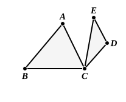
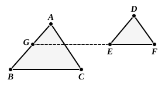
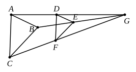

$ABC$ is a triangle. From $C$ draw $CD$ parallel to $BA$ and of any length. From $D$ draw $DE$ parallel to $CA$ and of such length that
$$CD : DE = BA : AC.$$
Then the triangles $ABC, ECD$, which have the angular point $C$ common literally satisfy Euclid's enunciation; but by no possibility can $CE$ be in a straight line with $CB$ if, as in the case supposed, the angles included by the corresponding sides are supplementary (unless both are right angles). Hence the included angles must be *equal*, so that the triangles must be *similar*. That being so, if they are to have nothing more than one angular point common, and two pairs of corresponding sides are to be *parallel* as distinguished from one or both being in the *same straight line*, the triangles can only be placed so that the corresponding sides in both are on the same side of the third side of either, and the sides (other than the third sides) which meet at the common angular point are not corresponding sides.

Todhunter remarks that the proposition seems of no use. Presumably he did not know that it is used by Euclid himself in XIII. 17. This is so however, and therefore it was not necessary, as several writers have thought, to do away with the proposition and find a substitute which should be more useful.

1. De Morgan proposes this theorem: "If two similar triangles be placed with their bases parallel, and the equal angles at the bases towards the same parts, the other sides are parallel, each to each; or one pair of sides are in the same straight line and the other pair are parallel."

2. Dr Lachlan substitutes the somewhat similar theorem, "If two similar triangles be placed so that two sides of the one are parallel to the corresponding sides of the other, the third sides are parallel."

But it is to be observed that these propositions can be proved without using Book VI. at all; they can be proved from Book I., and the triangles may as well be called "equiangular" simply. It is true that Book VI. is no more than formally necessary to Euclid's proposition. He merely uses VI. 6 because his enunciation does not say that the triangles are similar; and he only proves them to be similar in order to conclude that they are equiangular. From this point of view Mr Taylor's substitute seems the best, viz.

3. "If two triangles have sides parallel in pairs, the straight lines joining the corresponding vertices meet in a point, or are parallel."

Simson has a theory (unnecessary in the circumstances) as to the possible object of VI. 32 as it stands. He points out that the enunciation of VI. 26 might be more general so as to cover the case of similar and similarly situated parallelograms with equal angles not coincident but vertically opposite. It can then be proved that the diagonals drawn
