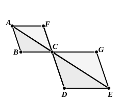

through the common angular point are in one straight line. If ">$ABCF$, ">$CDEG$ be similar and similarly situated parallelograms, so that $BCG$, $DCF$ are straight lines, and if the diagonals $AC$, $CE$ be drawn, the triangles ">$ABC$, ">$CDE$ are similar and are *placed exactly as described in* VI. 32, so that $AC$, $CE$ are in a straight line. Hence Simson suggests that there may have been, in addition to the indirect demonstration in VI. 26, a *direct proof* covering the case just given which may have used the result of VI. 32. I think however that the place given to the latter proposition in Book VI. is against this view.

---

### PROPOSITION 33.

*In equal circles angles have the same ratio as the circumferences on which they stand, whether they stand at the centres or at the circumferences.*

Let $ABC$, $DEF$ be equal circles, and let the angles $BGC$, $EHF$ be angles at their centres $G$, $H$, and the angles $BAC$, $EDF$ angles at the circumferences;

I say that, as the circumference $BC$ is to the circumference $EF$, so is the angle $BGC$ to the angle $EHF$, and the angle $BAC$ to the angle $EDF$.

For let any number of consecutive circumferences $CK$, $KL$ be made equal to the circumference $BC$,
and any number of consecutive circumferences $FM$, $MN$ equal to the circumference $EF$;
and let $GK$, $GL$, $HM$, $HN$ be joined.

Then, since the circumferences $BC$, $CK$, $KL$ are equal to one another,
the angles $BGC$, $CGK$, $KGL$ are also equal to one another; [III. 27]
