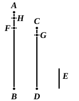

BOOK VII. PROPOSITIONS.

### PROPOSITION 1.

*Two unequal numbers being set out, and the less being continually subtracted in turn from the greater, if the number which is left never measures the one before it until an unit is left, the original numbers will be prime to one another.*

For, the less of two unequal numbers $AB$, $CD$ being continually subtracted from the greater, let the number which is left never measure the one before it until an unit is left;
I say that $AB$, $CD$ are prime to one another, that is, that an unit alone measures $AB$, $CD$.

For, if $AB$, $CD$ are not prime to one another, some number will measure them.

Let a number measure them, and let it be $E$; let $CD$, measuring $BF$, leave $FA$ less than itself,
let $AF$, measuring $DG$, leave $GC$ less than itself,
and let $GC$, measuring $FH$, leave an unit $HA$.

Since, then, $E$ measures $CD$, and $CD$ measures $BF$, therefore $E$ also measures $BF$.

But it also measures the whole $BA$;
therefore it will also measure the remainder $AF$.

But $AF$ measures $DG$;
therefore $E$ also measures $DG$.
