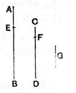

### PROPOSITION 2.

*Given two numbers not prime to one another, to find their greatest common measure.*

Let *AB*, *CD* be the two given numbers not prime to one another.

Thus it is required to find the greatest common measure of *AB*, *CD*.

If now *CD* measures *AB*—and it also measures itself—*CD* is a common measure of *CD*, *AB*.

And it is manifest that it is also the greatest; for no greater number than *CD* will measure *CD*.

But, if *CD* does not measure *AB*, then, the less of the numbers *AB*, *CD* being continually subtracted from the greater, some number will be left which will measure the one before it.

For an unit will not be left; otherwise *AB*, *CD* will be prime to one another [VII. 1], which is contrary to the hypothesis.

Therefore some number will be left which will measure the one before it.

Now let *CD*, measuring *BE*, leave *EA* less than itself, let *EA*, measuring *DF*, leave *FC* less than itself, and let *CF* measure *AE*.

Since then, *CF* measures *AE*, and *AE* measures *DF*, therefore *CF* will also measure *DF*.

But it also measures itself;
therefore it will also measure the whole *CD*.

But *CD* measures *BE*;
therefore *CF* also measures *BE*.

But it also measures *EA*;
therefore it will also measure the whole *BA*.

But it also measures *CD*;
therefore *CF* measures *AB*, *CD*.

Therefore *CF* is a common measure of *AB*, *CD*.
