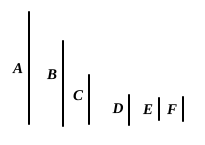

Similarly $e$ must measure $b - qc$, that is, $d$: which is impossible, since $e$ is 
by hypothesis greater than $d$.

Therefore etc.

Euclid's proposition is thus *identical* with the algebraical proposition as 
generally given, e.g. in Todhunter's algebra, except that of course Euclid's 
numbers are integers.

Nicomachus gives the same rule (though without proving it) when he 
shows how to determine whether two given *odd* numbers are prime or not 
prime to one another, and, if they are not prime to one another, what is their 
common measure. We are, he says, to compare the numbers in turn by 
continually taking the less from the greater as many times as possible, 
then taking the remainder as many times as possible from the less of the 
original numbers, and so on; this process "will finish either at an unit or at 
some one and the same number," by which it is implied that the division of a 
greater number by a less is done by *separate subtractions* of the less. Thus, 
with regard to 21 and 49, Nicomachus says, "I subtract the less from the 
greater; 28 is left; then again I subtract from this the same 21 (for this is 
possible); 7 is left; I subtract this from 21, 14 is left; from which I again 
subtract 7 (for this is possible); 7 will be left, but 7 cannot be subtracted from 
7." The last phrase is curious, but the meaning of it is obvious enough, as 
also the meaning of the phrase about ending "at one and the same number."

The proof of the Porism is of course contained in that part of the propo- 
sition which proves that $G$, a common measure different from $CF$, must 
measure $CF$. The supposition, thereby proved to be false, that $G$ is greater 
than $CF$ does not affect the validity of the proof that $G$ measures $CF$ in any 
case.

---

### PROPOSITION 3.

Given three numbers not prime to one another, to find their 
greatest common measure.

Let $A$, $B$, $C$ be the three given numbers not prime to 
one another ; 
thus it is required to find the greatest 
common measure of $A$, $B$, $C$.

For let the greatest common measure, 
$D$, of the two numbers $A$, $B$ be taken ; [VII. 2] 
then $D$ either measures, or does not 
measure, $C$.

First, let it measure it.

But it measures $A$, $B$ also ;

therefore $D$ measures $A$, $B$, $C$ ;

therefore $D$ is a common measure of $A$, $B$, $C$.

I say that it is also the greatest.
