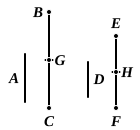

### PROPOSITION 5.

*If a number be a part of a number, and another be the same part of another, the sum will also be the same part of the sum that the one is of the one.*

For let the number $A$ be a part of $BC$,
and another, $D$, the same part of another $EF$ that $A$ is of $BC$;
I say that the sum of $A$, $D$ is also the same
part of the sum of $BC$, $EF$ that $A$ is of $BC$.

For since, whatever part $A$ is of $BC$, $D$
is also the same part of $EF$,
therefore, as many numbers as there are in
$BC$ equal to $A$, so many numbers are there
also in $EF$ equal to $D$.

Let $BC$ be divided into the numbers equal to $A$, namely
$BG$, $GC$,
and $EF$ into the numbers equal to $D$, namely $EH$, $HF$;
then the multitude of $BG$, $GC$ will be equal to the multitude
of $EH$, $HF$.

And, since $BG$ is equal to $A$, and $EH$ to $D$,
therefore $BG$, $EH$ are also equal to $A$, $D$.

For the same reason
$GC$, $HF$ are also equal to $A$, $D$.

Therefore, as many numbers as there are in $BC$ equal to
$A$, so many are there also in $BC$, $EF$ equal to $A$, $D$.

Therefore, whatever multiple $BC$ is of $A$, the same multiple
also is the sum of $BC$, $EF$ of the sum of $A$, $D$.

Therefore, whatever part $A$ is of $BC$, the same part also
is the sum of $A$, $D$ of the sum of $BC$, $EF$.

Q. E. D.

---

If
$$a = \frac{1}{n}b, \text{ and } c = \frac{1}{n}d, \text{ then}$$
$$a + c = \frac{1}{n}(b + d).$$

The proposition is of course true for any quantity of pairs of numbers
similarly related, as is the next proposition also; and both propositions are
used in the extended form in VII. 9, 10.
