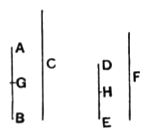

### PROPOSITION 6.

*If a number be parts of a number, and another be the same
parts of another, the sum will also be the same parts of the sum
that the one is of the one.*

For let the number $AB$ be parts of the number $C$,
and another, $DE$, the same parts of another,
$F$, that $AB$ is of $C$;
I say that the sum of $AB$, $DE$ is also the
same parts of the sum of $C$, $F$ that $AB$ is
of $C$.

For since, whatever parts $AB$ is of $C$,
$DE$ is also the same parts of $F$,
therefore, as many parts of $C$ as there are
in $AB$, so many parts of $F$ are there also in $DE$.

Let $AB$ be divided into the parts of $C$, namely $AG$, $GB$,
and $DE$ into the parts of $F$, namely $DH$, $HE$;
thus the multitude of $AG$, $GB$ will be equal to the multitude
of $DH$, $HE$.

And since, whatever part $AG$ is of $C$, the same part is
$DH$ of $F$ also,
therefore, whatever part $AG$ is of $C$, the same part also is the
sum of $AG$, $DH$ of the sum of $C$, $F$. [VII. 5]

For the same reason,
whatever part $GB$ is of $C$, the same part also is the sum of
$GB$, $HE$ of the sum of $C$, $F$.

Therefore, whatever parts $AB$ is of $C$, the same parts also
is the sum of $AB$, $DE$ of the sum of $C$, $F$.

Q. E. D.

---

If
$$a = \frac{m}{n}b, \text{ and } c = \frac{m}{n}d,$$
then
$$a + c = \frac{m}{n}(b + d).$$

More generally, if
$$a = \frac{m}{n}b,\ c = \frac{m}{n}d,\ e = \frac{m}{n}f, \dots$$
then
$$(a + c + e + g + \dots) = \frac{m}{n}(b + d + f + h + \dots).$$
