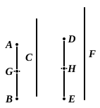

But $BG$ is equal to $A$, and $EH$ to $D$;
therefore, whatever part or parts $A$ is of $D$, the same part or
the same parts is $BC$ of $EF$ also.

Q. E. D.

---

If $a = \frac{1}{n}b$ and $c = \frac{1}{n}d$, then, whatever fraction ("part" or "parts") $a$ is of
$c$, the same fraction will $b$ be of $d$.

Dividing $b$ into each of its parts equal to $a$, and $d$ into each of its parts
equal to $c$, it is clear that, whatever fraction one of the parts $a$ is of one of the
parts $c$, the same fraction is any other of the parts $a$ of any other of the parts $c$.

And the number of the parts $a$ is equal to the number of the parts $c$, viz. $n$.

Therefore, by VII. 5, 6, $na$ is the same fraction of $nc$ that $a$ is of $c$, i.e. $b$ is
the same fraction of $d$ that $a$ is of $c$.

---

### PROPOSITION 10.

*If a number be parts of a number, and another be the
same parts of another, alternately also, whatever parts or part
the first is of the third, the same parts or the same part will
the second also be of the fourth.*

For let the number $AB$ be parts of the number $C$,
and another, $DE$, the same parts of another,
$F$;
I say that, alternately also, whatever parts or
part $AB$ is of $DE$, the same parts or the
same part is $C$ of $F$ also.

For since, whatever parts $AB$ is of $C$,
the same parts also is $DE$ of $F$,
therefore, as many parts of $C$ as there are
in $AB$, so many parts also of $F$ are there in $DE$.

Let $AB$ be divided into the parts of $C$, namely $AG$, $GB$,
and $DE$ into the parts of $F$, namely $DH$, $HE$;
thus the multitude of $AG$, $GB$ will be equal to the multitude
of $DH$, $HE$.

Now since, whatever part $AG$ is of $C$, the same part also
is $DH$ of $F$,
alternately also, whatever part or parts $AG$ is of $DH$,
the same part or the same parts is $C$ of $F$ also. [VII. 9]

For the same reason also,
whatever part or parts $GB$ is of $HE$, the same part or the
same parts is $C$ of $F$ also;
