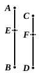

so that, in addition, whatever parts or part $AB$ is of $DE$, the same parts also, or the same part, is $C$ of $F$. [VII. 5, 6]

Q. E. D.

---

If $a = \frac{m}{n} b$ and $c = \frac{m}{n} d$, then, whatever fraction $a$ is of $c$, the same fraction is $b$ of $d$.

To prove this, $a$ is divided into its $m$ parts equal to $b/n$, and $c$ into its $m$ parts equal to $d/n$.

Then, by VII. 9, whatever fraction one of the $m$ parts of $a$ is of one of the $m$ parts of $c$, the same fraction is $b$ of $d$.

And, by VII. 5, 6, whatever fraction one of the $m$ parts of $a$ is of one of the $m$ parts of $c$, the same fraction is the sum of the parts of $a$ (that is, $a$) of the sum of the parts of $c$ (that is, $c$).

Whence the result follows.

In the Greek text, after the words "so that, in addition" in the last line but one, is an additional explanation making the reference to VII. 5, 6 clearer, as follows: "whatever part or parts $AG$ is of $DH$, the same part or the same parts is $GB$ of $HE$ also;

therefore also, whatever part or parts $AG$ is of $DH$, the same part or the same parts is $AB$ of $DE$ also. [VII. 5, 6]

But it was proved that, whatever part or parts $AG$ is of $DH$, the same part or the same parts is $C$ of $F$ also;

therefore also" etc. as in the last two lines of the text.

Heiberg concludes, on the authority of P, which only has the words in the margin in a later hand, that they may be attributed to Theon.

### PROPOSITION 11.

*If, as whole is to whole, so is a number subtracted to a number subtracted, the remainder will also be to the remainder as whole to whole.*

As the whole $AB$ is to the whole $CD$, so let $AE$ subtracted be to $CF$ subtracted;

I say that the remainder $EB$ is also to the remainder $FD$ as the whole $AB$ to the whole $CD$.

Since, as $AB$ is to $CD$, so is $AE$ to $CF$, whatever part or parts $AB$ is of $CD$, the same part or the same parts is $AE$ of $CF$ also; [VII. Def. 20]

Therefore also the remainder $EB$ is the same part or parts of $FD$ that $AB$ is of $CD$. [VII. 7, 8]

Therefore, as $EB$ is to $FD$, so is $AB$ to $CD$. [VII. Def. 20]

Q. E. D.

---

It will be observed that, in dealing with the proportions in Props. 11—13, Euclid only contemplates the case where the first number is "a part" or "parts" of the second, while in Prop. 13 he assumes the first to be "a part"
