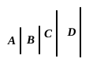

or "parts" of the third also; that is, the first number is in all three propositions assumed to be less than the second, and in Prop. 13 less than the third also. Yet the figures in Props. 11 and 13 are inconsistent with these assumptions. If the facts are taken to correspond to the figures in these propositions, it is necessary to take account of the other possibilities involved in the definition of proportion (VII. Def. 20), that the first number may also be a multiple, or a multiple *plus* "a part" or "parts" (including *once* as a multiple in this case), of each number with which it is compared. Thus a number of different cases would have to be considered. The remedy is to make the ratio which is in the lower terms the first ratio, and to invert the ratios, if necessary, in order to make "a part" or "parts" literally apply.

$$
\begin{aligned}
\text{If} \quad & a : b = c : d, \quad (a > c, b > d) \\
\text{then} \quad & (a - c) : (b - d) = a : b.
\end{aligned}
$$

This proposition for numbers corresponds to V. 19 for magnitudes. The enunciation is the same except that the masculine (agreeing with ἀριθμός) takes the place of the neuter (agreeing with μέγεθος).

The proof is no more than a combination of the arithmetical definition of proportion (VII. Def. 20) with the results of VII. 7, 8. The language of proportions is turned into the language of fractions by Def. 20; the results of VII. 7, 8 are then used and the language retransformed by Def. 20 into the language of proportions.

### PROPOSITION 12.

*If there be as many numbers as we please in proportion, then, as one of the antecedents is to one of the consequents, so are all the antecedents to all the consequents.*

Let $A, B, C, D$ be as many numbers as we please in proportion, so that,

as $A$ is to $B$, so is $C$ to $D$;

I say that, as $A$ is to $B$, so are $A, C$ to $B, D$.

For since, as $A$ is to $B$, so is $C$ to $D$, whatever part or parts $A$ is of $B$, the same part or parts is $C$ of $D$ also. [VII. Def. 20]

Therefore also the sum of $A, C$ is the same part or the same parts of the sum of $B, D$ that $A$ is of $B$. [VII. 5, 6]

Therefore, as $A$ is to $B$, so are $A, C$ to $B, D$. [VII. Def. 20]

---

$$
\begin{aligned}
\text{If} \quad & a : a' = b : b' = c : c' = \dots, \\
\text{then each ratio is equal to} \quad & (a + b + c + \dots) : (a' + b' + c' + \dots).
\end{aligned}
$$

The proposition corresponds to V. 12, and the enunciation is word for word the same with that of V. 12 except that ἀριθμός takes the place of μέγεθος.

Again the proof merely connects the arithmetical definition of proportion (VII. Def. 20) with the results of VII. 5, 6, which are quoted as true for any number of numbers, and not merely for two numbers as in the enunciations of VII. 5, 6.
