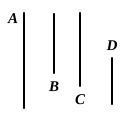

### PROPOSITION 13.

If four numbers be proportional, they will also be propor- 
tional alternately.

Let the four numbers $A$, $B$, $C$, $D$ be proportional, so that, 
as $A$ is to $B$, so is $C$ to $D$;

I say that they will also be proportional alternately, so that, 
as $A$ is to $C$, so will $B$ be to $D$.

For since, as $A$ is to $B$, so is $C$ to $D$,

therefore, whatever part or parts $A$ is of $B$, 
the same part or the same parts is $C$ of $D$ also. [VII. Def. 20]

Therefore, alternately, whatever part or 
parts $A$ is of $C$, the same part or the same 
parts is $B$ of $D$ also. [VII. 10]

Therefore, as $A$ is to $C$, so is $B$ to $D$. [VII. Def. 20]

Q. E. D.

---

$$
\begin{aligned}
\text{If} \quad & a : b = c : d, \\
\text{then, alternately,} \quad & a : c = b : d.
\end{aligned}
$$

The proposition corresponds to V. 16 for magnitudes, and the proof 
consists in connecting VII. Def. 20 with the result of VII. 10.

### PROPOSITION 14.

If there be as many numbers as we please, and others equal 
to them in multitude, which taken two and two are in the same 
ratio, they will also be in the same ratio ex aequali.

Let there be as many numbers as we please $A$, $B$, $C$, 
and others equal to them in multitude $D$, $E$, $F$, which taken 
two and two are in the same ratio, so that, 
as $A$ is to $B$, so is $D$ to $E$, 
and, 
as $B$ is to $C$, so is $E$ to $F$;

I say that, *ex aequali*, 
as $A$ is to $C$, so also is $D$ to $F$.

For, since, as $A$ is to $B$, so is $D$ to $E$,

therefore, alternately, 
as $A$ is to $D$, so is $B$ to $E$. [VII. 13]

