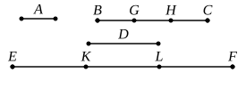

For let the unit $A$ measure any number $BC$, and let another number $D$ measure any other number $EF$ the same number of times;

I say that, alternately also, the unit $A$ measures the number $D$ the same number of times that $BC$ measures $EF$.

For, since the unit $A$ measures the number $BC$ the same number of times that $D$ measures $EF$, therefore, as many units as there are in $BC$, so many numbers equal to $D$ are there in $EF$ also.

Let $BC$ be divided into the units in it, $BG$, $GH$, $HC$, and $EF$ into the numbers $EK$, $KL$, $LF$ equal to $D$.

Thus the multitude of $BG$, $GH$, $HC$ will be equal to the multitude of $EK$, $KL$, $LF$.

And, since the units $BG$, $GH$, $HC$ are equal to one another, and the numbers $EK$, $KL$, $LF$ are also equal to one another, while the multitude of the units $BG$, $GH$, $HC$ is equal to the multitude of the numbers $EK$, $KL$, $LF$, therefore, as the unit $BG$ is to the number $EK$, so will the unit $GH$ be to the number $KL$, and the unit $HC$ to the number $LF$.

Therefore also, as one of the antecedents is to one of the consequents, so will all the antecedents be to all the consequents; [VII. 12]

therefore, as the unit $BG$ is to the number $EK$, so is $BC$ to $EF$.

But the unit $BG$ is equal to the unit $A$, and the number $EK$ to the number $D$.

Therefore, as the unit $A$ is to the number $D$, so is $BC$ to $EF$.

Therefore the unit $A$ measures the number $D$ the same number of times that $BC$ measures $EF$.

Q. E. D.

---

If there be four numbers $1, m, a, ma$ (such that $1$ measures $m$ the same number of times that $a$ measures $ma$), $1$ measures $a$ the same number of times that $m$ measures $ma$.

Except that the first number is unity and the numbers are said to *measure* instead of being a *part* of others, this proposition and its proof do not differ from VII. 9; in fact this proposition is a particular case of the other.
