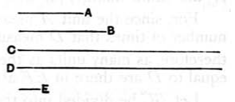

### PROPOSITION 16.

*If two numbers by multiplying one another make certain numbers, the numbers so produced[^316_1] will be equal to one another.*

Let $A, B$ be two numbers, and let $A$ by multiplying $B$ make $C$, and $B$ by multiplying $A$ make $D$;

I say that $C$ is equal to $D$.

For, since $A$ by multiplying $B$ has made $C$, therefore $B$ measures $C$ according to the units in $A$.

But the unit $E$ also measures the number $A$ according to the units in it;

therefore the unit $E$ measures $A$ the same number of times that $B$ measures $C$.

Therefore, alternately, the unit $E$ measures the number $B$ the same number of times that $A$ measures $C$. [VII. 15]

Again, since $B$ by multiplying $A$ has made $D$, therefore $A$ measures $D$ according to the units in $B$.

But the unit $E$ also measures $B$ according to the units in it;

therefore the unit $E$ measures the number $B$ the same number of times that $A$ measures $D$.

But the unit $E$ measured the number $B$ the same number of times that $A$ measures $C$;

therefore $A$ measures each of the numbers $C, D$ the same number of times.

Therefore $C$ is equal to $D$.

Q. E. D.

[^316_1]: **2. The numbers so produced.** The Greek has οἱ γενόμενοι ἐξ αὐτῶν, "the (numbers) produced *from them*." By "from them" Euclid means "from the original numbers," though this is not very clear even in the Greek. I think ambiguity is best avoided by leaving out the words.

---

This proposition proves that, *if any numbers be multiplied together, the order of multiplication is indifferent*, or $ab = ba$.

It is important to get a clear understanding of what Euclid means when he speaks of *one number multiplying another*. VII. Def. 15 states that the effect of "$a$ multiplying $b$" is taking $a$ times $b$. We shall always represent "$a$ times $b$" by $ab$ and "$b$ times $a$" by $ba$. This being premised, the proof that $ab = ba$ may be represented as follows in the language of proportions.
