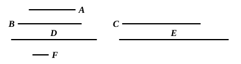

$$
\begin{aligned}
\text{By VII. Def. 20,} \quad & 1 : a = b : ab. \\
\text{Therefore, alternately,} \quad & 1 : b = a : ab. \quad \text{[VII. 13]} \\
\text{Again, by VII. Def. 20,} \quad & 1 : b = a : ba. \\
\text{Therefore} \quad & a : ab = a : ba, \\
\text{or} \quad & ab = ba.
\end{aligned}
$$

Euclid does not use the language of proportions but that of fractions or their equivalent measures, quoting VII. 15, a particular case of VII. 13 differently expressed, instead of VII. 13 itself.

### PROPOSITION 17.

*If a number by multiplying two numbers make certain numbers, the numbers so produced will have the same ratio as the numbers multiplied.*

For let the number $A$ by multiplying the two numbers $B$, $C$ make $D$, $E$;

I say that, as $B$ is to $C$, so is $D$ to $E$.

For, since $A$ by multiplying $B$ has made $D$, therefore $B$ measures $D$ according to the units in $A$.

But the unit $F$ also measures the number $A$ according to the units in it;

therefore the unit $F$ measures the number $A$ the same number of times that $B$ measures $D$.

Therefore, as the unit $F$ is to the number $A$, so is $B$ to $D$. [VII. Def. 20]

For the same reason,

as the unit $F$ is to the number $A$, so also is $C$ to $E$;

therefore also, as $B$ is to $D$, so is $C$ to $E$.

Therefore, alternately, as $B$ is to $C$, so is $D$ to $E$. [VII. 13]

Q. E. D.

---

$b : c = ab : ac$.

In this case Euclid translates the language of measures into that of proportions, and the proof is exactly like that set out in the last note.

$$
\begin{aligned}
\text{By VII. Def. 20,} \quad & 1 : a = b : ab, \\
\text{and} \quad & 1 : a = c : ac. \\
\text{Therefore} \quad & b : ab = c : ac, \\
\text{and, alternately,} \quad & b : c = ab : ac. \quad \text{[VII. 13]}
\end{aligned}
$$
