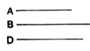

### PROPOSITION 18.

*If two numbers by multiplying any number make certain numbers, the numbers so produced will have the same ratio as the multipliers.*

For let two numbers $A$, $B$ by multiplying any number $C$ make $D$, $E$;
I say that, as $A$ is to $B$, so is $D$ to $E$.

For, since $A$ by multiplying $C$ has made $D$,
therefore also $C$ by multiplying $A$ has made $D$. [VII. 16]
For the same reason also
$C$ by multiplying $B$ has made $E$.
Therefore the number $C$ by multiplying the two numbers $A$, $B$ has made $D$, $E$.
Therefore, as $A$ is to $B$, so is $D$ to $E$. [VII. 17]

---

It is here proved that
$$a : b = ac : bc.$$
The argument is as follows.
$$\begin{aligned}
ac &= ca. & \text{[VII. 16]} \\
\text{Similarly}\qquad bc &= cb. \\
\text{And}\qquad a : b &= ca : cb; & \text{[VII. 17]} \\
\text{therefore}\qquad a : b &= ac : bc.
\end{aligned}$$

### PROPOSITION 19.

*If four numbers be proportional, the number produced from the first and fourth will be equal to the number produced from the second and third; and, if the number produced from the first and fourth be equal to that produced from the second and third, the four numbers will be proportional.*

Let $A$, $B$, $C$, $D$ be four numbers in proportion, so that,
as $A$ is to $B$, so is $C$ to $D$;
and let $A$ by multiplying $D$ make $E$, and let $B$ by multiplying $C$ make $F$;
I say that $E$ is equal to $F$.
For let $A$ by multiplying $C$ make $G$.
