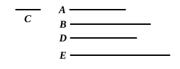

### PROPOSITION 18.

If two numbers by multiplying any number make certain 
numbers, the numbers so produced will have the same ratio as 
the multipliers.

For let two numbers $A$, $B$ by multiplying any number $C$ 
make $D$, $E$;

I say that, as $A$ is to $B$, so is $D$ 
to $E$.

For, since $A$ by multiplying 
$C$ has made $D$,

therefore also $C$ by multiplying $A$ has made $D$. [VII. 16]

For the same reason also 
$C$ by multiplying $B$ has made $E$.

Therefore the number $C$ by multiplying the two numbers 
$A$, $B$ has made $D$, $E$.

Therefore, as $A$ is to $B$, so is $D$ to $E$. [VII. 17]

---

It is here proved that
$$a : b = ac : bc.$$
The argument is as follows.
$$\begin{aligned}
ac &= ca. & \text{[VII. 16]} \\
\text{Similarly}\qquad bc &= cb. \\
\text{And}\qquad a : b &= ca : cb; & \text{[VII. 17]} \\
\text{therefore}\qquad a : b &= ac : bc.
\end{aligned}$$

### PROPOSITION 19.

If four numbers be proportional, the number produced from 
the first and fourth will be equal to the number produced from 
the second and third; and, if the number produced from the 
first and fourth be equal to that produced from the second and 
third, the four numbers will be proportional.

Let $A$, $B$, $C$, $D$ be four numbers in proportion, so that, 
as $A$ is to $B$, so is $C$ to $D$; 
and let $A$ by multiplying $D$ make $E$, and let $B$ by multiply- 
ing $C$ make $F$;

I say that $E$ is equal to $F$.

For let $A$ by multiplying $C$ make $G$.
