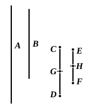

(2) Since
$$ad = bc,$$
$$ac : ad = ac : bc.$$
$$\begin{aligned}
\text{But}\qquad ac : ad &= c : d, & \text{[VII. 17]} \\
\text{and}\qquad ac : bc &= a : b. & \text{[VII. 18]} \\
\text{Therefore}\qquad a : b &= c : d.
\end{aligned}$$

As indicated in the note on VII. 14 above, Heiberg regards Euclid as basing the inferences contained in the last step of part (1) of this proof and in the first step of part (2) on the propositions V. 9 and V. 7 respectively, since he has not proved those propositions separately for numbers in this Book. I prefer to suppose that he regarded the inferences as obvious and not needing proof, in view of the definition of numbers which are in proportion. E.g., if $ac$ is the same fraction ("part" or "parts") of $ad$ that $ac$ is of $bc$, it is obvious that $ad$ must be equal to $bc$.

Heiberg omits from his text here, and relegates to an Appendix, a proposition appearing in the manuscripts V, p, $\phi$ to the effect that, *if three numbers be proportional, the product of the extremes is equal to the square of the mean, and conversely*. It does not appear in P in the first hand, B has it in the margin only, and Campanus omits it, remarking that Euclid does not give the proposition about *three* proportionals as he does in VI. 17, since it is easily proved by the proposition just given. Moreover an-Nairīzī quotes the proposition about three proportionals as an observation on VII. 19 probably due to Heron (who is mentioned by name in the preceding paragraph).

---

### PROPOSITION 20.

*The least numbers of those which have the same ratio with them measure those which have the same ratio the same number of times, the greater the greater and the less the less.*

For let $CD$, $EF$ be the least numbers of those which have the same ratio with $A$, $B$;
I say that $CD$ measures $A$ the same number of times that $EF$ measures $B$.

Now $CD$ is not parts of $A$.
For, if possible, let it be so;
therefore $EF$ is also the same parts of $B$ that $CD$ is of $A$. [VII. 13 and Def. 20]
Therefore, as many parts of $A$ as there are in $CD$, so many parts of $B$ are there also in $EF$.
Let $CD$ be divided into the parts of $A$, namely $CG$, $GD$, and $EF$ into the parts of $B$, namely $EH$, $HF$;
thus the multitude of $CG$, $GD$ will be equal to the multitude of $EH$, $HF$.
