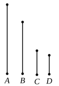

And, as many times as $C$ measures $A$, so many units 
let there be in $D$, 
and, as many times as $C$ measures $B$, so many units let there 
be in $E$.

Since $C$ measures $A$ according to the units in $D$,

therefore $C$ by multiplying $D$ has made $A$. [VII. Def. 15]

For the same reason also

$C$ by multiplying $E$ has made $B$.

Thus the number $C$ by multiplying the two numbers $D$, 
$E$ has made $A$, $B$ ;

therefore, as $D$ is to $E$, so is $A$ to $B$ ; [VII. 17]

therefore $D$, $E$ are in the same ratio with $A$, $B$, being less 
than they : which is impossible.

Therefore no number will measure the numbers $A$, $B$.

Therefore $A$, $B$ are prime to one another.

Q. E. D.

---

If $a : b$ is "in its lowest terms," $a$, $b$ are prime to one another. 
Again the proof is indirect. 
If $a$, $b$ are not prime to one another, they have some common measure $c$, 
and
$$a = mc, \quad b = nc.$$
Therefore
$$m : n = a : b. \qquad \text{[VII. 17 or 18]}$$
But $m$, $n$ are less than $a$, $b$ respectively, so that $a : b$ is not in its lowest 
terms : which is contrary to the hypothesis. 
Therefore etc.

---

### PROPOSITION 23.

If two numbers be prime to one another, the number which 
measures the one of them will be prime to the remaining 
number.

Let $A$, $B$ be two numbers prime to one another, and let 
any number $C$ measure $A$;

I say that $C$, $B$ are also prime to one another.

For, if $C$, $B$ are not prime to one another, 
some number will measure $C$, $B$.

Let a number measure them, and let it be $D$.

Since $D$ measures $C$, and $C$ measures $A$,

therefore $D$ also measures $A$.

But it also measures $B$ ;

