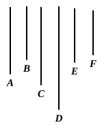

therefore $D$ measures $A$, $B$ which are prime to one another : 
which is impossible. [VII. Def. 12]

Therefore no number will measure the numbers $C$, $B$.

Therefore $C$, $B$ are prime to one another.

Q. E. D.

---

If $a$, $mb$ are prime to one another, $b$ is prime to $a$. For, if not, some 
number $d$ will measure both $a$ and $b$, and therefore both $a$ and $mb$: which is 
contrary to the hypothesis. 
Therefore etc.

---

### PROPOSITION 24.

If two numbers be prime to any number, their product also 
will be prime to the same.

For let the two numbers $A$, $B$ be prime to any number $C$, 
and let $A$ by multiplying $B$ make $D$;

I say that $C$, $D$ are prime to one another.

For, if $C$, $D$ are not prime to one another, 
some number will measure $C$, $D$.

Let a number measure them, and let it 
be $E$.

Now, since $C$, $A$ are prime to one 
another, 
and a certain number $E$ measures $C$,

therefore $A$, $E$ are prime to one another. [VII. 23]

As many times, then, as $E$ measures $D$, so many units let 
there be in $F$;

therefore $F$ also measures $D$ according to the units in $E$. [VII. 16]

Therefore $E$ by multiplying $F$ has made $D$. [VII. Def. 15]

But, further, $A$ by multiplying $B$ has also made $D$ ;

therefore the product of $E$, $F$ is equal to the product of $A$, $B$.

But, if the product of the extremes be equal to that of the 
means, the four numbers are proportional ; [VII. 19]

therefore, as $E$ is to $A$, so is $B$ to $F$.

But $A$, $E$ are prime to one another, 
numbers which are prime to one another are also the least of 
those which have the same ratio, [VII. 21] 
and the least numbers of those which have the same ratio 
with them measure those which have the same ratio the same

