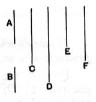

### Proposition 27.

*If two numbers be prime to one another, and each by multiplying itself make a certain number, the products will be prime to one another; and, if the original numbers by multiplying the products make certain numbers, the latter will also be prime to one another [and this is always the case with the extremes].*

Let $A$, $B$ be two numbers prime to one another, let $A$ by multiplying itself make $C$, and by multiplying $C$ make $D$, and let $B$ by multiplying itself make $E$, and by multiplying $E$ make $F$;
I say that both $C$, $E$ and $D$, $F$ are prime to one another.

For, since $A$, $B$ are prime to one another, and $A$ by multiplying itself has made $C$, therefore $C$, $B$ are prime to one another. [VII. 25]

Since then $C$, $B$ are prime to one another, and $B$ by multiplying itself has made $E$, therefore $C$, $E$ are prime to one another. [id.]

Again, since $A$, $B$ are prime to one another, and $B$ by multiplying itself has made $E$, therefore $A$, $E$ are prime to one another. [id.]

Since then the two numbers $A$, $C$ are prime to the two numbers $B$, $E$, both to each, therefore also the product of $A$, $C$ is prime to the product of $B$, $E$. [VII. 26]

And the product of $A$, $C$ is $D$, and the product of $B$, $E$ is $F$.

Therefore $D$, $F$ are prime to one another.

$$\text{Q. E. D.}$$

---

If $a$, $b$ are prime to one another, so are $a^2$, $b^2$ and so are $a^3$, $b^3$; and, generally, $a^n$, $b^n$ are prime to one another.

The words in the enunciation which assert the truth of the proposition for *any* powers are suspected and bracketed by Heiberg because (1) in περὶ τοὺς ἄκρους the use of ἄκροι is peculiar, for it can only mean "the last products," and (2) the words have nothing corresponding to them in the proof, much less is the generalisation proved. Campanus omits the words in the enuncia-
