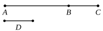

tion, though he adds to the proof a remark that the proposition is true of any, 
the same or different, powers of $a$, $b$. Heiberg concludes that the words are 
an interpolation of date earlier than Theon.

Euclid's proof amounts to this.

Since $a$, $b$ are prime to one another, so are $a^2$, $b$ [VII. 25], and therefore 
also $a^2$, $b^2$. [VII. 25]

Similarly [VII. 25] $a$, $b^2$ are prime to one another.

Therefore $a$, $a^2$ and $b$, $b^2$ satisfy the description in the enunciation of 
VII. 26.

Hence $a^3$, $b^3$ are prime to one another.

---

### PROPOSITION 28.

If two numbers be prime to one another, the sum will also 
be prime to each of them ; and, if the sum of two numbers be 
prime to any one of them, the original numbers will also be 
prime to one another.

For let two numbers $AB$, $BC$ prime to one another be 
added ; 
I say that the sum $AC$ is also prime 
to each of the numbers $AB$, $BC$.

For, if $CA$, $AB$ are not prime to 
one another, 
some number will measure $CA$, $AB$.

Let a number measure them, and let it be $D$.

Since then $D$ measures $CA$, $AB$,

therefore it will also measure the remainder $BC$.

But it also measures $BA$ ;

therefore $D$ measures $AB$, $BC$ which are prime to one another : 
which is impossible. [VII. Def. 12]

Therefore no number will measure the numbers $CA$, $AB$ ; 
therefore $CA$, $AB$ are prime to one another.

For the same reason

$AC$, $CB$ are also prime to one another.

Therefore $CA$ is prime to each of the numbers $AB$, $BC$.

Again, let $CA$, $AB$ be prime to one another ; 
I say that $AB$, $BC$ are also prime to one another.

For, if $AB$, $BC$ are not prime to one another, 
some number will measure $AB$, $BC$.

