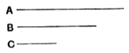

If $c$, a prime number, measure $ab$, $c$ will measure either $a$ or $b$.
Suppose $c$ does not measure $a$.
Therefore $c$, $a$ are prime to one another. [VII. 29]
Suppose
$$ab = mc.$$
Therefore
$$c : a = b : m. \quad \text{[VII. 19]}$$
Hence [VII. 20, 21] $c$ measures $b$.
Similarly, if $c$ does not measure $b$, it measures $a$.
Therefore it measures one or other of the two numbers $a$, $b$.

---

### PROPOSITION 31.

*Any composite number is measured by some prime number.*

Let $A$ be a composite number;
I say that $A$ is measured by some prime number.

For, since $A$ is composite,
5 some number will measure it.
Let a number measure it, and let it be $B$.

Now, if $B$ is prime, what was enjoined will have been done.
10 But if it is composite, some number will measure it.
Let a number measure it, and let it be $C$.

Then, since $C$ measures $B$,
and $B$ measures $A$,
therefore $C$ also measures $A$.
15 And, if $C$ is prime, what was enjoined will have been done.
But if it is composite, some number will measure it.

Thus, if the investigation be continued in this way, some prime number will be found which will measure the number 20 before it, which will also measure $A$.

For, if it is not found, an infinite series of numbers will measure the number $A$, each of which is less than the other: which is impossible in numbers.

Therefore some prime number will be found which will 25 measure the one before it, which will also measure $A$.

Therefore any composite number is measured by some prime number.
