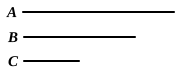

If $c$, a prime number, measure $ab$, $c$ will measure either $a$ or $b$.
Suppose $c$ does not measure $a$.
Therefore $c$, $a$ are prime to one another. [VII. 29]
Suppose
$$ab = mc.$$
Therefore
$$c : a = b : m. \quad \text{[VII. 19]}$$
Hence [VII. 20, 21] $c$ measures $b$.
Similarly, if $c$ does not measure $b$, it measures $a$.
Therefore it measures one or other of the two numbers $a$, $b$.

---

### PROPOSITION 31.

Any composite number is measured by some prime number.

Let $A$ be a composite number; 
I say that $A$ is measured by some prime number.

For, since $A$ is composite, 
5 some number will measure it.

Let a number measure it, and let it 
be $B$.

Now, if $B$ is prime, what was en- 
joined will have been done.

10 But if it is composite, some number will measure it.

Let a number measure it, and let it be $C$.

Then, since $C$ measures $B$, 
and $B$ measures $A$,

therefore $C$ also measures $A$.

15 And, if $C$ is prime, what was enjoined will have been 
done.

But if it is composite, some number will measure it.

Thus, if the investigation be continued in this way, some 
prime number will be found which will measure the number 
20 before it, which will also measure $A$.

For, if it is not found, an infinite series of numbers will 
measure the number $A$, each of which is less than the other: 
which is impossible in numbers.

Therefore some prime number will be found which will 
25 measure the one before it, which will also measure $A$.

Therefore any composite number is measured by some 
prime number.

