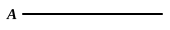

VII. 31—33] PROPOSITIONS 30—33 333

**8. if $B$ is prime, what was enjoined will have been done,** *i.e.* the implied *problem* of finding a prime number which measures $A$.

**18. some prime number will be found which will measure.** In the Greek the sentence stops here, but it is necessary to add the words "the number before it, which will also measure $A$," which are found a few lines further down. It is possible that the words may have fallen out of P here by a simple mistake due to ὁμοιοτέλευτον (Heiberg).

Heiberg relegates to the Appendix an alternative proof of this proposition, to the following effect. Since $A$ is composite, some number will measure it. Let $B$ be the *least* such number. I say that $B$ is prime. For, if not, $B$ is composite, and some number will measure it, say $C$; so that $C$ is less than $B$. But, since $C$ measures $B$, and $B$ measures $A$, $C$ must measure $A$. And $C$ is less than $B$: which is contrary to the hypothesis.

---

### PROPOSITION 32.

*Any number either is prime or is measured by some prime number.*

Let $A$ be a number;
I say that $A$ either is prime or is measured by some prime number.

If now $A$ is prime, that which was enjoined will have been done.

But if it is composite, some prime number will measure it. [VII. 31]

Therefore any number either is prime or is measured by some prime number.

Q. E. D.

---

### PROPOSITION 33.

*Given as many numbers as we please, to find the least of those which have the same ratio with them.*

Let $A, B, C$ be the given numbers, as many as we please;
thus it is required to find the least of
5 those which have the same ratio with
$A, B, C$.

$A, B, C$ are either prime to one
another or not.

Now, if $A, B, C$ are prime to one
10 another, they are the least of those
which have the same ratio with them.
[VII. 21]

But, if not, let $D$ the greatest common measure of $A, B, C$ be taken, [VII. 3]
