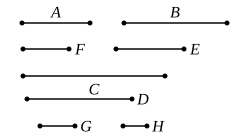

VII. 34] PROPOSITION 34 337

Therefore $A$, $B$ do not measure any number less than $C$;
therefore $C$ is the least that is measured by $A$, $B$.

Next, let $A$, $B$ not be prime to one another,
and let $F$, $E$, the least numbers of those which have the same ratio with $A$, $B$, be taken; [VII. 33]
therefore the product of $A$, $E$ is equal to the product of $B$, $F$. [VII. 19]

And let $A$ by multiplying $E$ make $C$;
therefore also $B$ by multiplying $F$ has made $C$;
therefore $A$, $B$ measure $C$.

I say next that it is also the least number that they measure.

For, if not, $A$, $B$ will measure some number which is less than $C$.

Let them measure $D$.

And, as many times as $A$ measures $D$, so many units let there be in $G$,
and, as many times as $B$ measures $D$, so many units let there be in $H$.

Therefore $A$ by multiplying $G$ has made $D$,
and $B$ by multiplying $H$ has made $D$.

Therefore the product of $A$, $G$ is equal to the product of $B$, $H$;
therefore, as $A$ is to $B$, so is $H$ to $G$. [VII. 19]

But, as $A$ is to $B$, so is $F$ to $E$.

Therefore also, as $F$ is to $E$, so is $H$ to $G$.

But $F$, $E$ are least,
and the least measure the numbers which have the same ratio the same number of times, the greater the greater and the less the less; [VII. 20]
therefore $E$ measures $G$.

And, since $A$ by multiplying $E$, $G$ has made $C$, $D$,
therefore, as $E$ is to $G$, so is $C$ to $D$. [VII. 17]

But $E$ measures $G$;
therefore $C$ also measures $D$, the greater the less:
which is impossible.
