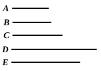

### PROPOSITION 35.

*If two numbers measure any number, the least number measured by them will also measure the same.*

For let the two numbers $A$, $B$ measure any number $CD$, and let $E$ be the least that they measure;
I say that $E$ also measures $CD$.

For, if $E$ does not measure $CD$, let $E$, measuring $DF$, leave $CF$ less than itself.

Now, since $A$, $B$ measure $E$, and $E$ measures $DF$, therefore $A$, $B$ will also measure $DF$.

But they also measure the whole $CD$; therefore they will also measure the remainder $CF$ which is less than $E$: which is impossible.

Therefore $E$ cannot fail to measure $CD$; therefore it measures it.

Q. E. D.

---

The *least common multiple* of any two numbers must measure any other common multiple.

The proof is obvious, depending on the fact that, if any number divides $a$ and $b$, it also divides $a - pb$.

---

### PROPOSITION 36.

*Given three numbers, to find the least number which they measure.*

Let $A$, $B$, $C$ be the three given numbers; thus it is required to find the least number which they measure.

Let $D$, the least number measured by the two numbers $A$, $B$, be taken. [VII. 34]

Then $C$ either measures, or does not measure, $D$.

First, let it measure it.
