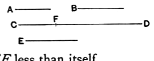
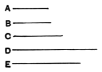

### PROPOSITION 35.

*If two numbers measure any number, the least number measured by them will also measure the same.*

For let the two numbers *A*, *B* measure any number *CD*, and let *E* be the least that they measure;
I say that *E* also measures *CD*.

For, if *E* does not measure *CD*, let *E*, measuring *DF*, leave *CF* less than itself.

Now, since *A*, *B* measure *E*, and *E* measures *DF*, therefore *A*, *B* will also measure *DF*.

But they also measure the whole *CD*; therefore they will also measure the remainder *CF* which is less than *E*: which is impossible.

Therefore *E* cannot fail to measure *CD*; therefore it measures it.

Q. E. D.

---

The *least common multiple* of any two numbers must measure any other common multiple.

The proof is obvious, depending on the fact that, if any number divides *a* and *b*, it also divides *a* − *pb*.

---

### PROPOSITION 36.

*Given three numbers, to find the least number which they measure.*

Let *A*, *B*, *C* be the three given numbers; thus it is required to find the least number which they measure.

Let *D*, the least number measured by the two numbers *A*, *B*, be taken. [VII. 34]

Then *C* either measures, or does not measure, *D*.

First, let it measure it.
