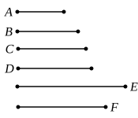

But $A$, $B$ also measure $D$;

therefore $A$, $B$, $C$ measure $D$.

I say next that it is also the least that they measure.

For, if not, $A$, $B$, $C$ will measure some number which is 
less than $D$.

Let them measure $E$.

Since $A$, $B$, $C$ measure $E$,

therefore also $A$, $B$ measure $E$.

Therefore the least number measured by $A$, $B$ will also 
measure $E$. [VII. 35]

But $D$ is the least number measured by $A$, $B$;

therefore $D$ will measure $E$, the greater the less: 
which is impossible.

Therefore $A$, $B$, $C$ will not measure any number which is 
less than $D$;

therefore $D$ is the least that $A$, $B$, $C$ measure.

Again, let $C$ not measure $D$, 
and let $E$, the least number measured by 
$C$, $D$, be taken. [VII. 34]

Since $A$, $B$ measure $D$, 
and $D$ measures $E$,

therefore also $A$, $B$ measure $E$.

But $C$ also measures $E$;

therefore also $A$, $B$, $C$ measure $E$.

I say next that it is also the least that they measure.

For, if not, $A$, $B$, $C$ will measure some number which 
is less than $E$.

Let them measure $F$.

Since $A$, $B$, $C$ measure $F$,

therefore also $A$, $B$ measure $F$;

therefore the least number measured by $A$, $B$ will also 
measure $F$. [VII. 35]

But $D$ is the least number measured by $A$, $B$;

therefore $D$ measures $F$.

But $C$ also measures $F$;

therefore $D$, $C$ measure $F$, 
so that the least number measured by $D$, $C$ will also measure $F$.

