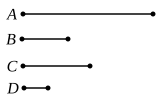

But *E* is the least number measured by *C*, *D*; therefore *E* measures *F*, the greater the less: which is impossible.

Therefore *A*, *B*, *C* will not measure any number which is less than *E*.

Therefore *E* is the least that is measured by *A*, *B*, *C*.

Q. E. D.

---

Euclid's rule for finding the L.C.M. of *three numbers a, b, c* is the rule with which we are familiar. The L.C.M. of *a, b* is first found, say *d*, and then the L.C.M. of *d* and *c* is found.

Euclid distinguishes the cases (1) in which *c* measures *d*, (2) in which *c* does not measure *d*. We need only reproduce the proof of the general case (2). The method is that of *reductio ad absurdum*.

Let *e* be the L.C.M. of *d, c*.

Since *a, b* both measure *d*, and *d* measures *e*,

<i>a</i>, <i>b</i> both measure <i>e</i>.

So does *c*.

Therefore *e* is *some* common multiple of *a, b, c*.

If it is not the *least*, let *f* be the L.C.M.

Now *a, b* both measure *f*; therefore *d*, their L.C.M., also measures *f*. [VII. 35]

Thus *d, c* both measure *f*; therefore *e*, their L.C.M., measures *f*: [VII. 35]
which is impossible, since *f* &lt; *e*.

Therefore etc.

The process can be continued *ad libitum*, so that we can find the L.C.M., not only of three, but of as many numbers as we please.

---

### PROPOSITION 37.

*If a number be measured by any number, the number which is measured will have a part called by the same name as the measuring number.*

For let the number *A* be measured by any number *B*; I say that *A* has a part called by the same name as *B*.

For, as many times as *B* measures *A*, so many units let there be in *C*.

Since *B* measures *A* according to the units in *C*, and the unit *D* also measures the number *C* according to the units in it,
