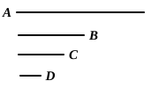

therefore the unit $D$ measures the number $C$ the same number 
of times as $B$ measures $A$.

Therefore, alternately, the unit $D$ measures the number $B$ 
the same number of times as $C$ measures $A$; [VII. 15] 
therefore, whatever part the unit $D$ is of the number $B$, the 
same part is $C$ of $A$ also.

But the unit $D$ is a part of the number $B$ called by the 
same name as it;

therefore $C$ is also a part of $A$ called by the same name as $B$, 
so that $A$ has a part $C$ which is called by the same name as $B$.

Q. E. D.

---

If $b$ measures $a$, then $\frac{1}{b}\text{th}$ of $a$ is a whole number.

Let $a = m \cdot b$. 
Now $m = m \cdot 1$. 
Thus $1, m, b, a$ satisfy the enunciation of VII. 15; 
therefore $m$ measures $a$ the same number of times that $1$ measures $b$.

But $1$ is $\frac{1}{b}\text{th}$ part of $b$; 
therefore $m$ is $\frac{1}{b}\text{th}$ part of $a$.

---

### PROPOSITION 38.

If a number have any part whatever, it will be measured 
by a number called by the same name as the part.

For let the number $A$ have any part whatever, $B$, 
and let $C$ be a number called by the same 
name as the part $B$;

I say that $C$ measures $A$.

For, since $B$ is a part of $A$ called by 
the same name as $C$, 
and the unit $D$ is also a part of $C$ called 
by the same name as it,

therefore, whatever part the unit $D$ is of the number $C$, 
the same part is $B$ of $A$ also;

therefore the unit $D$ measures the number $C$ the same number 
of times that $B$ measures $A$.

