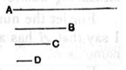

therefore the unit *D* measures the number *C* the same number of times as *B* measures *A*.

Therefore, alternately, the unit *D* measures the number *B* the same number of times as *C* measures *A*; [VII. 15] therefore, whatever part the unit *D* is of the number *B*, the same part is *C* of *A* also.

But the unit *D* is a part of the number *B* called by the same name as it; therefore *C* is also a part of *A* called by the same name as *B*, so that *A* has a part *C* which is called by the same name as *B*.

Q. E. D.

---

If *b* measures *a*, then $\frac{1}{b}\text{th}$ of *a* is a whole number.

Let $a = m \cdot b$.

Now $m = m \cdot 1$.

Thus $1, m, b, a$ satisfy the enunciation of VII. 15; therefore $m$ measures $a$ the same number of times that $1$ measures $b$.

But $1$ is $\frac{1}{b}\text{th}$ part of $b$; therefore $m$ is $\frac{1}{b}\text{th}$ part of $a$.

---

### PROPOSITION 38.

*If a number have any part whatever, it will be measured by a number called by the same name as the part.*

For let the number *A* have any part whatever, *B*, and let *C* be a number called by the same name as the part *B*; I say that *C* measures *A*.

For, since *B* is a part of *A* called by the same name as *C*, and the unit *D* is also a part of *C* called by the same name as it, therefore, whatever part the unit *D* is of the number *C*, the same part is *B* of *A* also; therefore the unit *D* measures the number *C* the same number of times that *B* measures *A*.
