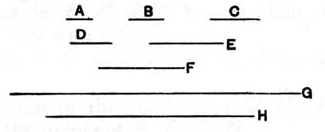

Therefore, alternately, the unit *D* measures the number *B* the same number of times that *C* measures *A*. [VII. 15]

Therefore *C* measures *A*.

Q. E. D.

---

This proposition is practically a restatement of the preceding proposition.

It asserts that, if *b* is $\frac{1}{m}\text{th}$ part of *a*, i.e., if $b = \frac{1}{m} a$, then *m* measures *a*.

We have $b = \frac{1}{m} a$, and $1 = \frac{1}{m} m$.

Therefore $1, m, b, a$, satisfy the enunciation of VII. 15, and therefore *m* measures *a* the same number of times as $1$ measures *b*, or
$$m = \frac{1}{b} a.$$

---

### PROPOSITION 39.

*To find the number which is the least that will have given parts.*

Let *A*, *B*, *C* be the given parts; thus it is required to find the number which is the least that will have the parts *A*, *B*, *C*.

Let *D*, *E*, *F* be numbers called by the same name as the parts *A*, *B*, *C*, and let *G*, the least number measured by *D*, *E*, *F*, be taken. [VII. 36]

Therefore *G* has parts called by the same name as *D*, *E*, *F*. [VII. 37]

But *A*, *B*, *C* are parts called by the same name as *D*, *E*, *F*; therefore *G* has the parts *A*, *B*, *C*.

I say next that it is also the least number that has.
