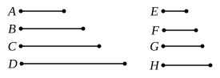

# BOOK VIII.

## PROPOSITION 1.

If there be as many numbers as we please in continued 
proportion, and the extremes of them be prime to one another, 
the numbers are the least of those which have the same ratio 
with them.

Let there be as many numbers as we please, $A$, $B$, $C$, $D$, 
in continued proportion, 
and let the extremes of them 
$A$, $D$ be prime to one another;

I say that $A$, $B$, $C$, $D$ are the 
least of those which have the 
same ratio with them.

For, if not, let $E$, $F$, $G$, $H$ be less than $A$, $B$, $C$, $D$, and 
in the same ratio with them.

Now, since $A$, $B$, $C$, $D$ are in the same ratio with $E$, $F$, 
$G$, $H$, 
and the multitude of the numbers $A$, $B$, $C$, $D$ is equal to the 
multitude of the numbers $E$, $F$, $G$, $H$,

therefore, *ex aequali*, 
as $A$ is to $D$, so is $E$ to $H$. [VII. 14]

But $A$, $D$ are prime, 
primes are also least, [VII. 21] 
and the least numbers measure those which have the same 
ratio the same number of times, the greater the greater and 
the less the less, that is, the antecedent the antecedent and 
the consequent the consequent. [VII. 20]

