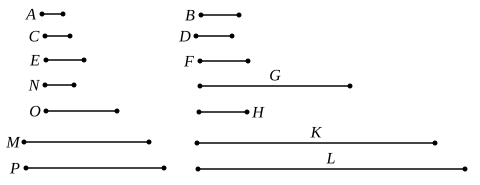

# BOOK VIII.

## PROPOSITION 4.

Given as many ratios as we please in least numbers, to find 
numbers in continued proportion which are the least in the 
given ratios.

Let the given ratios in least numbers be that of $A$ to $B$, 
5 that of $C$ to $D$, and that of $E$ to $F$; 
thus it is required to find numbers in continued proportion 
which are the least that are in the ratio of $A$ to $B$, in the 
ratio of $C$ to $D$, and in the ratio of $E$ to $F$.

Let $G$, the least number measured by $B$, $C$, be taken. [VII. 34]

10 And, as many times as $B$ measures $G$, so many times also 
let $A$ measure $H$, 
and, as many times as $C$ measures $G$, so many times also let 
$D$ measure $K$.

Now $E$ either measures or does not measure $K$.

15 First, let it measure it.

And, as many times as $E$ measures $K$, so many times let 
$F$ measure $L$ also.

Now, since $A$ measures $H$ the same number of times that 
$B$ measures $G$,

20 therefore, as $A$ is to $B$, so is $H$ to $G$. [VII. Def. 20, VII. 13]

For the same reason also, 
as $C$ is to $D$, so is $G$ to $K$,
and further, as $E$ is to $F$, so is $K$ to $L$;

therefore $H$, $G$, $K$, $L$ are continuously proportional in the 
25 ratio of $A$ to $B$, in the ratio of $C$ to $D$, and in the ratio of $E$ 
to $F$.

I say next that they are also the least that have this 
property.
