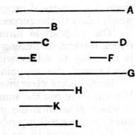

### PROPOSITION 5.

*Plane numbers have to one another the ratio compounded of the ratios of their sides.*

Let *A*, *B* be plane numbers, and let the numbers *C*, *D* be the sides of *A*, and *E*, *F* of *B*;
5 I say that *A* has to *B* the ratio compounded of the ratios of the sides.

For, the ratios being given which *C* has to *E* and *D* to *F*, let the least numbers *G*, *H*, *K* that are continuously
10 in the ratios *C* : *E*, *D* : *F* be taken, so that,
$$\text{as } C \text{ is to } E\text{, so is } G \text{ to } H\text{,}$$
and,
$$\text{as } D \text{ is to } F\text{, so is } H \text{ to } K.\hfill\text{[VIII. 4]}$$

And let *D* by multiplying *E* make *L*.

15 Now, since *D* by multiplying *C* has made *A*, and by multiplying *E* has made *L*,
therefore, as *C* is to *E*, so is *A* to *L*. [VII. 17]

But, as *C* is to *E*, so is *G* to *H*;
therefore also, as *G* is to *H*, so is *A* to *L*.

20 Again, since *E* by multiplying *D* has made *L*, and further by multiplying *F* has made *B*,
therefore, as *D* is to *F*, so is *L* to *B*. [VII. 17]

But, as *D* is to *F*, so is *H* to *K*;
therefore also, as *H* is to *K*, so is *L* to *B*.

25 But it was also proved that,
$$\text{as } G \text{ is to } H\text{, so is } A \text{ to } L\text{;}$$
therefore, *ex aequali*,
$$\text{as } G \text{ is to } K\text{, so is } A \text{ to } B.\hfill\text{[VII. 14]}$$

But *G* has to *K* the ratio compounded of the ratios of the
30 sides;
therefore *A* also has to *B* the ratio compounded of the ratios of the sides.

Q. E. D.

---

**1, 5, 29, 31. compounded of the ratios of their sides.** As in VI. 23, the Greek has the less exact phrase, "compounded of their sides."

If
$$a = cd,\quad b = ef,$$
then $a$ has to $b$ the ratio compounded of $c : e$ and $d : f$.

Take three numbers the least which are continuously in the given ratios.
