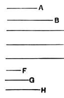

If $l$ is the L.C.M. of $e$, $d$ and $l = me = nd$, the three numbers are
$$\left. \begin{array}{r} mc,\, me \\ = nd \end{array} \right\},\, nf.\hfill\text{[VIII. 4]}$$

Now
$$\begin{aligned}
dc : de &= c : e\hfill\text{[VII. 17]}\\
&= mc : me = mc : nd.
\end{aligned}$$

Also
$$\begin{aligned}
ed : ef &= d : f\hfill\text{[VII. 17]}\\
&= nd : nf.
\end{aligned}$$

Therefore, *ex aequali*,
$$\begin{aligned}
cd : ef &= mc : nf\\
&= (\text{ratio compounded of } c : e \text{ and } d : f).
\end{aligned}$$

It will be seen that this proof follows exactly the method of VI. 23 for parallelograms.

---

### PROPOSITION 6.

*If there be as many numbers as we please in continued proportion, and the first do not measure the second, neither will any other measure any other.*

Let there be as many numbers as we please, *A*, *B*, *C*, *D*, *E*, in continued proportion, and let *A* not measure *B*;
I say that neither will any other measure any other.

Now it is manifest that *A*, *B*, *C*, *D*, *E* do not measure one another in order; for *A* does not even measure *B*.

I say, then, that neither will any other measure any other.
For, if possible, let *A* measure *C*.

And, however many *A*, *B*, *C* are, let as many numbers *F*, *G*, *H*, the least of those which have the same ratio with *A*, *B*, *C*, be taken. [VII. 33]

Now, since *F*, *G*, *H* are in the same ratio with *A*, *B*, *C*, and the multitude of the numbers *A*, *B*, *C* is equal to the multitude of the numbers *F*, *G*, *H*,
therefore, *ex aequali*, as *A* is to *C*, so is *F* to *H*. [VII. 14]
