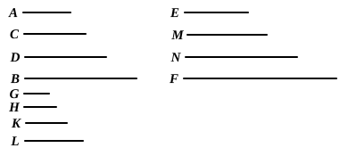

### PROPOSITION 8.

*If between two numbers there fall numbers in continued proportion with them, then, however many numbers fall between them in continued proportion, so many will also fall in continued proportion between the numbers which have the same ratio with the original numbers.*

Let the numbers $C$, $D$ fall between the two numbers $A$, $B$ in continued proportion with them, and let $E$ be made in the same ratio to $F$ as $A$ is to $B$;
I say that, as many numbers as have fallen between $A$, $B$ in continued proportion, so many will also fall between $E$, $F$ in continued proportion.

For, as many as $A$, $B$, $C$, $D$ are in multitude, let so many numbers $G$, $H$, $K$, $L$, the least of those which have the same ratio with $A$, $C$, $D$, $B$, be taken; [VII. 33]
therefore the extremes of them $G$, $L$ are prime to one another. [VIII. 3]

Now, since $A$, $C$, $D$, $B$ are in the same ratio with $G$, $H$, $K$, $L$,
and the multitude of the numbers $A$, $C$, $D$, $B$ is equal to the multitude of the numbers $G$, $H$, $K$, $L$,
therefore, *ex aequali*, as $A$ is to $B$, so is $G$ to $L$. [VII. 14]

But, as $A$ is to $B$, so is $E$ to $F$;
therefore also, as $G$ is to $L$, so is $E$ to $F$.

But $G$, $L$ are prime,
primes are also least, [VII. 21]
and the least numbers measure those which have the same ratio the same number of times, the greater the greater and the less the less, that is, the antecedent the antecedent and the consequent the consequent. [VII. 20]
