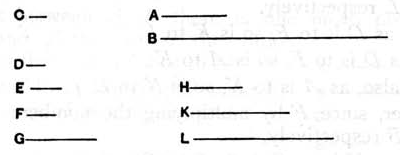

For let the numbers *D*, *E* and *F*, *G* respectively fall between the two numbers *A*, *B* and the unit *C* in continued proportion;
I say that, as many numbers as have fallen between each of the numbers *A*, *B* and the unit *C* in continued proportion, so many numbers will also fall between *A*, *B* in continued proportion.

For let *D* by multiplying *F* make *H*, and let the numbers *D*, *F* by multiplying *H* make *K*, *L* respectively.

Now, since, as the unit *C* is to the number *D*, so is *D* to *E*, therefore the unit *C* measures the number *D* the same number of times as *D* measures *E*. [VII. Def. 20]

But the unit *C* measures the number *D* according to the units in *D*;
therefore the number *D* also measures *E* according to the units in *D*;
therefore *D* by multiplying itself has made *E*.

Again, since, as *C* is to the number *D*, so is *E* to *A*, therefore the unit *C* measures the number *D* the same number of times as *E* measures *A*.

But the unit *C* measures the number *D* according to the units in *D*;
therefore *E* also measures *A* according to the units in *D*;
therefore *D* by multiplying *E* has made *A*.

For the same reason also *F* by multiplying itself has made *G*, and by multiplying *G* has made *B*.

And, since *D* by multiplying itself has made *E* and by multiplying *F* has made *H*, therefore, as *D* is to *F*, so is *E* to *H*. [VII. 17]
