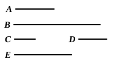

He infers namely that $D \times F : F \times F = D : F$. But since, by VII. 16, the order of multiplication is indifferent, he is practically justified in saying "for the same reason." The same thing occurs in later propositions.

### PROPOSITION 11.

*Between two square numbers there is one mean proportional number, and the square has to the square the ratio duplicate of that which the side has to the side.*

Let *A*, *B* be square numbers, and let *C* be the side of *A*, and *D* of *B*;
I say that between *A*, *B* there is one mean proportional number, and *A* has to *B* the ratio duplicate of that which *C* has to *D*.

For let *C* by multiplying *D* make *E*.

Now, since *A* is a square and *C* is its side,
therefore *C* by multiplying itself has made *A*.

For the same reason also
*D* by multiplying itself has made *B*.

Since then *C* by multiplying the numbers *C*, *D* has made *A*, *E* respectively,
therefore, as *C* is to *D*, so is *A* to *E*. [VII. 17]

For the same reason also,
> as *C* is to *D*, so is *E* to *B*. [VII. 18]

Therefore also, as *A* is to *E*, so is *E* to *B*.

Therefore between *A*, *B* there is one mean proportional number.

I say next that *A* also has to *B* the ratio duplicate of that which *C* has to *D*.

For, since *A*, *E*, *B* are three numbers in proportion,
therefore *A* has to *B* the ratio duplicate of that which *A* has to *E*. [V. Def. 9]

But, as *A* is to *E*, so is *C* to *D*.

Therefore *A* has to *B* the ratio duplicate of that which the side *C* has to *D*.

Q. E. D.

---

According to Nicomachus the theorems in this proposition and the next, that two squares have *one* geometric mean, and two cubes *two* geometric means, between them are Platonic. Cf. *Timaeus*, 32 A sqq. and the note thereon, p. 294 above.
