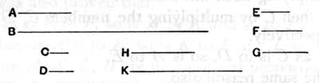

$a^2$, $b^2$ being two squares, it is only necessary to form the product $ab$ and to prove that
$$a^2,\quad ab,\quad b^2$$
are in geometrical progression. Euclid proves that
$$a^2 : ab = ab : b^2$$
by means of VII. 17, 18, as usual.

In assuming that, since $a^2$ is to $b^2$ in the duplicate ratio of $a^2$ to $ab$, $a^2$ is to $b^2$ in the duplicate ratio of $a$ to $b$, Euclid assumes that ratios which are the duplicates of equal ratios are equal. This, an obvious inference from V. 22, can be inferred just as easily for numbers from VII. 14.

### PROPOSITION 12.

*Between two cube numbers there are two mean proportional numbers, and the cube has to the cube the ratio triplicate of that which the side has to the side.*

Let *A*, *B* be cube numbers, and let *C* be the side of *A*, and *D* of *B*;
I say that between *A*, *B* there are two mean proportional numbers, and *A* has to *B* the ratio triplicate of that which *C* has to *D*.

For let *C* by multiplying itself make *E*, and by multiplying *D* let it make *F*;
let *D* by multiplying itself make *G*,
and let the numbers *C*, *D* by multiplying *F* make *H*, *K* respectively.

Now, since *A* is a cube, and *C* its side,
and *C* by multiplying itself has made *E*,
therefore *C* by multiplying itself has made *E* and by multiplying *E* has made *A*.

For the same reason also
*D* by multiplying itself has made *G* and by multiplying *G* has made *B*.

And, since *C* by multiplying the numbers *C*, *D* has made *E*, *F* respectively,
therefore, as *C* is to *D*, so is *E* to *F*. [VII. 17]
