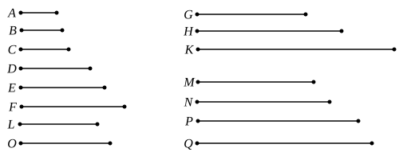

Let there be as many numbers as we please, *A*, *B*, *C*, in continued proportion, so that, as *A* is to *B*, so is *B* to *C*;
let *A*, *B*, *C* by multiplying themselves make *D*, *E*, *F*, and by multiplying *D*, *E*, *F* let them make *G*, *H*, *K*;
I say that *D*, *E*, *F* and *G*, *H*, *K* are in continued proportion.

For let *A* by multiplying *B* make *L*,
and let the numbers *A*, *B* by multiplying *L* make *M*, *N* respectively.

And again let *B* by multiplying *C* make *O*,
and let the numbers *B*, *C* by multiplying *O* make *P*, *Q* respectively.

Then, in manner similar to the foregoing, we can prove that
*D*, *L*, *E* and *G*, *M*, *N*, *H* are continuously proportional in the ratio of *A* to *B*,
and further *E*, *O*, *F* and *H*, *P*, *Q*, *K* are continuously proportional in the ratio of *B* to *C*.

Now, as *A* is to *B*, so is *B* to *C*;
therefore *D*, *L*, *E* are also in the same ratio with *E*, *O*, *F*,
and further *G*, *M*, *N*, *H* in the same ratio with *H*, *P*, *Q*, *K*.

And the multitude of *D*, *L*, *E* is equal to the multitude of *E*, *O*, *F*, and that of *G*, *M*, *N*, *H* to that of *H*, *P*, *Q*, *K*;
therefore, *ex aequali*,
> as *D* is to *E*, so is *E* to *F*,
and, as *G* is to *H*, so is *H* to *K*. [VII. 14]
