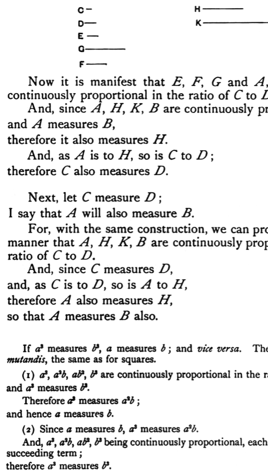

For let _C_ by multiplying itself make _E_, and let _D_ by multiplying itself make _G_; further, let _C_ by multiplying _D_ make _F_, and let _C_, _D_ by multiplying _F_ make _H_, _K_ respectively.

Now it is manifest that _E_, _F_, _G_ and _A_, _H_, _K_, _B_ are continuously proportional in the ratio of _C_ to _D_. [VIII. 11, 12]

And, since _A_, _H_, _K_, _B_ are continuously proportional, and _A_ measures _B_, therefore it also measures _H_. [VIII. 7]

And, as _A_ is to _H_, so is _C_ to _D_; therefore _C_ also measures _D_. [VII. Def. 20]

Next, let _C_ measure _D_; I say that _A_ will also measure _B_.

For, with the same construction, we can prove in a similar manner that _A_, _H_, _K_, _B_ are continuously proportional in the ratio of _C_ to _D_.

And, since _C_ measures _D_, and, as _C_ is to _D_, so is _A_ to _H_, therefore _A_ also measures _H_, [VII. Def. 20] so that _A_ measures _B_ also.

Q. E. D.

---

If $a^3$ measures $b^3$, $a$ measures $b$; and vice versa. The proof is, *mutatis mutandis*, the same as for squares.

(1) $a^3$, $a^2b$, $ab^2$, $b^3$ are continuously proportional in the ratio of $a$ to $b$; and $a^3$ measures $b^3$.

Therefore $a^3$ measures $a^2b$; [VIII. 7] and hence $a$ measures $b$.

(2) Since $a$ measures $b$, $a^3$ measures $a^2b$.

And, $a^3$, $a^2b$, $ab^2$, $b^3$ being continuously proportional, each term measures the succeeding term; therefore $a^3$ measures $b^3$.
