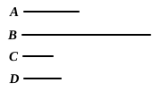

### PROPOSITION 16.

If a square number do not measure a square number, neither 
will the side measure the side; and, if the side do not measure 
the side, neither will the square measure the square.

Let $A$, $B$ be square numbers, and let $C$, $D$ be their sides; 
and let $A$ not measure $B$; 
I say that neither does $C$ measure $D$.

For, if $C$ measures $D$, $A$ will also 
measure $B$. [VIII. 14]

But $A$ does not measure $B$;

therefore neither will $C$ measure $D$.

Again, let $C$ not measure $D$; 
I say that neither will $A$ measure $B$.

For, if $A$ measures $B$, $C$ will also measure $D$. [VIII. 14]

But $C$ does not measure $D$;

therefore neither will $A$ measure $B$.

Q. E. D.

---

If $a^2$ does not measure $b^2$, $a$ will not measure $b$; and, if $a$ does not 
measure $b$, $a^2$ will not measure $b^2$.

The proof is a mere *reductio ad absurdum* using VIII. 14.

---

### PROPOSITION 17.

If a cube number do not measure a cube number, neither 
will the side measure the side; and, if the side do not measure 
the side, neither will the cube measure the cube.

For let the cube number $A$ not measure the cube 
number $B$, 
and let $C$ be the side of $A$, and $D$ 
of $B$; 
I say that $C$ will not measure $D$.

For if $C$ measures $D$, $A$ will 
also measure $B$. [VIII. 15]

But $A$ does not measure $B$;

therefore neither does $C$ measure $D$.

Again, let $C$ not measure $D$; 
I say that neither will $A$ measure $B$.
