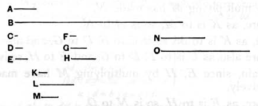

### PROPOSITION 19.

*Between two similar solid numbers there fall two mean proportional numbers; and the solid number has to the similar solid number the ratio triplicate of that which the corresponding side has to the corresponding side.*

Let _A_, _B_ be two similar solid numbers, and let _C_, _D_, _E_ be the sides of _A_, and _F_, _G_, _H_ of _B_.

Now, since similar solid numbers are those which have their sides proportional, [VII. Def. 21] therefore, as _C_ is to _D_, so is _F_ to _G_, and, as _D_ is to _E_, so is _G_ to _H_.

I say that between _A_, _B_ there fall two mean proportional numbers, and _A_ has to _B_ the ratio triplicate of that which _C_ has to _F_, _D_ to _G_, and also _E_ to _H_.

For let _C_ by multiplying _D_ make _K_, and let _F_ by multiplying _G_ make _L_.

Now, since _C_, _D_ are in the same ratio with _F_, _G_, and _K_ is the product of _C_, _D_, and _L_ the product of _F_, _G_, _K_, _L_ are similar plane numbers; [VII. Def. 21] therefore between _K_, _L_ there is one mean proportional number. [VIII. 18]

Let it be _M_.

Therefore _M_ is the product of _D_, _F_, as was proved in the theorem preceding this. [VIII. 18]

Now, since _D_ by multiplying _C_ has made _K_, and by multiplying _F_ has made _M_, therefore, as _C_ is to _F_, so is _K_ to _M_. [VII. 17]

But, as _K_ is to _M_, so is _M_ to _L_.

Therefore _K_, _M_, _L_ are continuously proportional in the ratio of _C_ to _F_.
