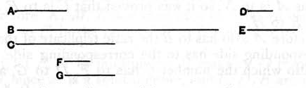

Again, since _D_, _E_ are the least of the numbers which have 15 the same ratio with _C_, _B_, therefore _D_ measures _C_ the same number of times that _E_ measures _B_. [VII. 20]

As many times, then, as _E_ measures _B_, so many units let there be in _G_; 20 therefore _E_ measures _B_ according to the units in _G_; therefore _G_ by multiplying _E_ has made _B_.

Therefore _B_ is plane, and _E_, _G_ are its sides.

Therefore _A_, _B_ are plane numbers.

I say next that they are also similar.

25 For, †[^376_1]since _F_ by multiplying _D_ has made _A_, and by multiplying _E_ has made _C_, therefore, as _D_ is to _E_, so is _A_ to _C_, that is, _C_ to _B_. [VII. 17]

Again,† since _E_ by multiplying _F_, _G_ has made _C_, _B_ respectively, 30 therefore, as _F_ is to _G_, so is _C_ to _B_. [VII. 17]

But, as _C_ is to _B_, so is _D_ to _E_; therefore also, as _D_ is to _E_, so is _F_ to _G_.

And alternately, as _D_ is to _F_, so is _E_ to _G_. [VII. 13]

Therefore _A_, _B_ are similar plane numbers; for their sides 35 are proportional.

Q. E. D.

---

[^376_1]: **25. For, †since F......27. C to B.** The text has clearly suffered corruption here. It is not necessary to infer from other facts that, as _D_ is to _E_, so is _A_ to _C_; for this is part of the hypotheses (ll. 6, 7). Again, there is no explanation of the statement (l. 25) that _F_ by multiplying _E_ has made _C_. It is the statement and explanation of this latter fact which are alone wanted; after which the proof proceeds in l. 28. We might therefore substitute for ll. 25—28 the following.  
"For, since _E_ measures _C_ the same number of times that _D_ measures _A_ [l. 8], that is, according to the units in _F_ [l. 10], therefore _F_ by multiplying _E_ has made _C_.  
And, since _E_ by multiplying _F_, _G_," etc. etc.

---

This proposition is the converse of VIII. 18. If $a, c, b$ are in geometrical progression, $a, b$ are "similar plane numbers."

Let $\alpha : \beta$ be the ratio $a : c$ (and therefore also the ratio $c : b$) in its lowest terms.

Then [VII. 20]
$$\begin{aligned}
a &= m\alpha, & c &= m\beta, && \text{where } m \text{ is some integer,} \\
c &= n\alpha, & b &= n\beta, && \text{where } n \text{ is some integer.}
\end{aligned}$$
