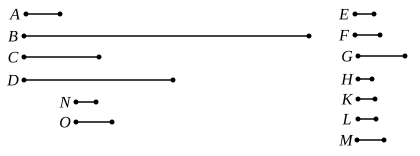

Thus $a$, $b$ are both products of two factors, i.e. plane.
Again,
$$\alpha : \beta = a : c = c : b$$
$$= m : n. \qquad \text{[VII. 18]}$$
Therefore, alternately,
$$\alpha : m = \beta : n, \qquad \text{[VII. 13]}$$
and hence $m\alpha$, $n\beta$ are similar plane numbers.
[Our notation makes the second part still more obvious, for $c = m\beta = n\alpha$.]

---

### PROPOSITION 21.

*If two mean proportional numbers fall between two numbers, the numbers are similar solid numbers.*

For let two mean proportional numbers $C$, $D$ fall between the two numbers $A$, $B$;
I say that $A$, $B$ are similar solid numbers.

For let three numbers $E$, $F$, $G$, the least of those which have the same ratio with $A$, $C$, $D$, be taken; [VII. 33 or VIII. 2]
therefore the extremes of them $E$, $G$ are prime to one another. [VIII. 3]

Now, since one mean proportional number $F$ has fallen between $E$, $G$,
therefore $E$, $G$ are similar plane numbers. [VIII. 20]

Let, then, $H$, $K$ be the sides of $E$, and $L$, $M$ of $G$.
Therefore it is manifest from the theorem before this that $E$, $F$, $G$ are continuously proportional in the ratio of $H$ to $L$ and that of $K$ to $M$.

Now, since $E$, $F$, $G$ are the least of the numbers which have the same ratio with $A$, $C$, $D$,
and the multitude of the numbers $E$, $F$, $G$ is equal to the multitude of the numbers $A$, $C$, $D$,
therefore, *ex aequali*, as $E$ is to $G$, so is $A$ to $D$. [VII. 14]

But $E$, $G$ are prime,
primes are also least, [VII. 21]
and the least measure those which have the same ratio with
