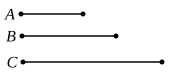
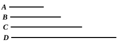

Then, by the proof of VIII. 20,
$$\alpha : \beta = m : p = n : q.$$
Now, *ex aequali*,
$$a : d = \alpha : \gamma, \qquad \text{[VII. 14]}$$
and, since $\alpha, \gamma$ are prime to one another,
$$a = r\alpha, \quad d = r\gamma, \quad \text{where } r \text{ is an integer.}$$
But $\alpha = mn$:
therefore $a = rmn$, and therefore $a$ is "solid."
Again, *ex aequali*,
$$c : b = \alpha : \gamma,$$
and therefore
$$c = s\alpha, \quad b = s\gamma, \quad \text{where } s \text{ is an integer.}$$
Thus $b = spq$, and $b$ is therefore "solid."
Now
$$\begin{aligned}
\alpha : \beta = a : c &= r\alpha : s\alpha \\
&= r : s.
\end{aligned} \qquad \text{[VII. 18]}$$
And, from above,
$$\alpha : \beta = m : p = n : q.$$
Therefore
$$r : s = m : p = n : q,$$
and hence $a, b$ are similar solid numbers.

---

### PROPOSITION 22.

*If three numbers be in continued proportion, and the first be square, the third will also be square.*

Let $A$, $B$, $C$ be three numbers in continued proportion,
and let $A$ the first be square;
I say that $C$ the third is also square.

For, since between $A$, $C$ there is one mean proportional number, $B$,
therefore $A$, $C$ are similar plane numbers. [VIII. 20]
But $A$ is square;
therefore $C$ is also square.
Q. E. D.

A mere application of VIII. 20 to the particular case where one of the "similar plane numbers" is square.

---

### PROPOSITION 23.

*If four numbers be in continued proportion, and the first be cube, the fourth will also be cube.*

Let $A$, $B$, $C$, $D$ be four numbers in continued proportion,
and let $A$ be cube;
I say that $D$ is also cube.

For, since between $A$, $D$ there are two mean proportional numbers $B$, $C$,
therefore $A$, $D$ are similar solid numbers. [VIII. 21]
