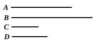

But $A$ is cube;

therefore $D$ is also cube.

Q. E. D.

---

A mere application of VIII. 21 to the case where one of the "similar solid 
numbers" is a cube.

---

### PROPOSITION 24.

If two numbers have to one another the ratio which a square 
number has to a square number, and the first be square, the 
second will also be square.

For let the two numbers $A$, $B$ have to one another the 
ratio which the square number $C$ has 
to the square number $D$, and let $A$ be 
square; 
I say that $B$ is also square.

For, since $C$, $D$ are square,

$C$, $D$ are similar plane numbers.

Therefore one mean proportional number falls between 
$C$, $D$. [VIII. 18]

And, as $C$ is to $D$, so is $A$ to $B$;

therefore one mean proportional number falls between $A$, $B$ 
also. [VIII. 8]

And $A$ is square;

therefore $B$ is also square. [VIII. 22]

Q. E. D.

---

If $a : b = c^2 : d^2$, and $a$ is a square, then $b$ is also a square.
For $c^2, d^2$ have one mean proportional $cd$. [VIII. 18]
Therefore $a, b$, which are in the same ratio, have one mean proportional. 
[VIII. 8]
And, since $a$ is square, $b$ must also be a square. [VIII. 22]

---

### PROPOSITION 25.

If two numbers have to one another the ratio which a cube 
number has to a cube number, and the first be cube, the second 
will also be cube.

For let the two numbers $A$, $B$ have to one another the 
ratio which the cube number $C$ has to the cube number $D$, 
and let $A$ be cube; 
I say that $B$ is also cube.
