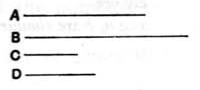

But $A$ is cube;
therefore $D$ is also cube.
Q. E. D.

---

A mere application of VIII. 21 to the case where one of the "similar solid numbers" is a cube.

---

### PROPOSITION 24.

*If two numbers have to one another the ratio which a square number has to a square number, and the first be square, the second will also be square.*

For let the two numbers $A$, $B$ have to one another the ratio which the square number $C$ has to the square number $D$, and let $A$ be square;
I say that $B$ is also square.

For, since $C$, $D$ are square,
$C$, $D$ are similar plane numbers.
Therefore one mean proportional number falls between $C$, $D$. [VIII. 18]
And, as $C$ is to $D$, so is $A$ to $B$;
therefore one mean proportional number falls between $A$, $B$ also. [VIII. 8]
And $A$ is square;
therefore $B$ is also square. [VIII. 22]
Q. E. D.

---

If $a : b = c^2 : d^2$, and $a$ is a square, then $b$ is also a square.
For $c^2, d^2$ have one mean proportional $cd$. [VIII. 18]
Therefore $a, b$, which are in the same ratio, have one mean proportional. [VIII. 8]
And, since $a$ is square, $b$ must also be a square. [VIII. 22]

---

### PROPOSITION 25.

*If two numbers have to one another the ratio which a cube number has to a cube number, and the first be cube, the second will also be cube.*

For let the two numbers $A$, $B$ have to one another the ratio which the cube number $C$ has to the cube number $D$, and let $A$ be cube;
I say that $B$ is also cube.
