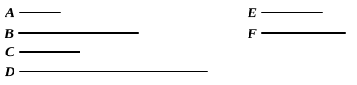

For, since $C$, $D$ are cube, 
$C$, $D$ are similar solid numbers.

Therefore two mean proportional numbers fall between 
$C$, $D$. [VIII. 19]

And, as many numbers as fall between $C$, $D$ in continued 
proportion, so many will also fall between those which have 
the same ratio with them; [VIII. 8]

so that two mean proportional numbers fall between $A$, $B$ 
also.

Let $E$, $F$ so fall.

Since, then, the four numbers $A$, $E$, $F$, $B$ are in continued 
proportion, 
and $A$ is cube,

therefore $B$ is also cube. [VIII. 23]

Q. E. D.

---

If $a : b = c^3 : d^3$, and $a$ is a cube, then $b$ is also a cube. 
For $c^3, d^3$ have two mean proportionals. [VIII. 19] 
Therefore $a, b$ also have two mean proportionals. [VIII. 8] 
And $a$ is a cube: 
therefore $b$ is a cube. [VIII. 23]

---

### PROPOSITION 26.

Similar plane numbers have to one another the ratio which 
a square number has to a square number.

Let $A$, $B$ be similar plane numbers; 
I say that $A$ has to $B$ the ratio which a square number has 
to a square number.

For, since $A$, $B$ are similar plane numbers,

therefore one mean proportional number falls between $A$, $B$. [VIII. 18]

